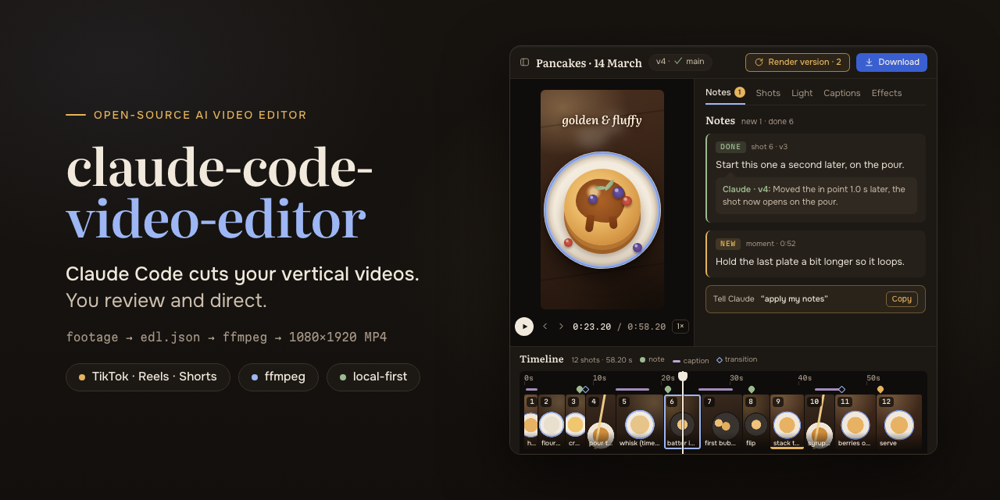

# claude-code-video-editor: AI video editor for TikTok, Reels and Shorts, driven by Claude Code

**claude-code-video-editor is an open-source, local AI video editor for vertical short-form cooking videos (TikTok, Instagram Reels, YouTube Shorts): Claude Code cuts your raw footage by writing an edit decision list, ffmpeg renders it, and you review the result and leave notes in a browser UI.**

You shoot the recipe, drop the clips in, and ask Claude for a cut. Claude picks the shots, trims them on completed actions, adds speed ramps and timelapses, and renders a 1080×1920 MP4. You watch it, pin notes to shots ("start this one a second later", "use the other take"), and Claude applies them in the next version. Ingest, rendering and review all run on your machine, and your video files are never uploaded.



Not affiliated with Anthropic, TikTok, Meta or Google.

## What is it?

claude-code-video-editor is a toolkit of Python scripts, an ffmpeg render pipeline and a local web app that together let Claude Code act as the editor of a short vertical video. The edit lives in one JSON file, `edl.json` (an edit decision list): a list of shots, each with a source clip, in and out points, speed, crop and sound. Claude edits that file; `tools/render.py` turns it into a finished MP4; the review UI at `http://127.0.0.1:8765` shows every rendered version and collects your feedback.

## Who is it for?

- Creators who film cooking or other step-by-step "process" videos for TikTok, Instagram Reels or YouTube Shorts and would rather review and direct an edit than make every cut by hand.
- Claude Code users who want a worked example of an agent doing creative work through files and command-line tools.
- Developers looking for a frame-exact, scriptable ffmpeg pipeline for vertical video (EDL in, MP4 out).

## How it works

1. **Ingest.** `tools/new_episode.py` unpacks zips or links folders of clips into `episodes/<name>/`, reads their metadata, makes 360p proxies and filmstrips, and measures sharpness, camera shake, motion and brightness ten times a second.
2. **First cut by Claude.** Claude Code looks at contact sheets of the footage, writes a shot log, and builds `edl.json`. Helper tools tell it where movements finish (`actions.py`) and where the camera bumps or drifts (`camera.py`).
3. **Render.** `tools/render.py` cuts every shot frame-exactly from the original files, caches each shot, joins them with ffmpeg and writes `renders/<name>_vN.mp4` plus a JSON snapshot of that version.
4. **Review.** You watch the version in the UI and leave notes pinned to a shot, a moment or the whole video. You can also adjust light, captions, transitions and effects yourself, or swap in another take.
5. **Revise.** You tell Claude "apply my notes". It reads them with `tools/instructions.py`, edits `edl.json`, renders the next version and replies to each note. The UI picks up the new version on its own.

```
footage (zip / folder) -> new_episode.py -> proxies, strips, analysis
                                              |
                       Claude Code edits edl.json  <-  your notes (instructions.json)
                                              |
                       render.py (ffmpeg) -> renders/<name>_vN.mp4 -> review UI
```

## Features

### Editing (Claude)

- Reviews footage through contact sheets (`tools/sheet.py`) and per-clip quality metrics, and keeps a shot log you can see in the footage library.
- Writes the whole edit as plain JSON: clip, in/out, speed or speed ramp, crop and zoom, volume and muted ranges for every shot.
- Cuts on completed actions using motion "still points" from `tools/actions.py`, so a knife stroke or a pour is never cut in half.
- Avoids camera bumps and only builds timelapses from clips where the camera stays still (`tools/camera.py`).
- Offers alternative takes for each shot on a shot board, with a one-line reason for each.
- Reads your notes with the exact shot and source frame they point to, applies them, and answers "done" or asks a question.
- Optional: with a local Whisper install (for example `mlx-whisper` on Apple Silicon), checks clips for speech and mutes it.

### Review UI

- **Edit without Claude**: reorder shots by drag and drop, remove them, change speed (slow motion, 1.5×, 2×,
  timelapse), volume and crop, insert new ranges from the footage, apply effects, undo / redo, and preview the
  draft edit straight from the footage before rendering.

- 9:16 player with note markers, frame stepping and 0.5× / 0.25× playback, plus a docked, zoomable timeline with thumbnails.
- Notes anchored to a shot, a moment or the whole video, with status (new, question, done) and Claude's reply under each.
- Shot board: alternative takes per shot, preview in place, one-click swap into the edit (with a backup of the previous `edl.json`).
- Clip editor with a zoomable range picker and the footage library beside it: insert a new shot or replace an existing one.
- Per-shot light sliders (brightness, contrast, temperature) on top of the automatic balance.
- Caption designer: Google Fonts, outline, box and shadow styles, and a TikTok safe-zone overlay. Captions stay attached to their shot when the edit changes.
- Transitions per cut (hard cut, fades, slides, wipes, zoom and other ffmpeg `xfade` types) with a quick preview.
- Effects library (colour looks, glow, diffusion, light leaks, vignette, grain, sharpening, slow push-in) with a live WebGL2 preview that matches the render; send the combination you like to Claude as a note.
- "Render version" button, version list, and download in 1080p or 4K.
- English and Ukrainian interface, keyboard shortcuts, and review from a phone on the same Wi-Fi (`python3 tools/server.py --lan`).

### Rendering

- Frame-exact cuts from the original sources; proxies are only used for preview.
- Per-shot cache keyed by a hash of everything that affects the pixels, so changing one shot re-renders only that shot.
- 1080×1920 H.264 MP4 (CRF 17, AAC audio, BT.709, fast start) and a 4K master (2160×3840) rebuilt from the originals with the same edit.
- Colour looks as 3D LUTs, generated from recipes so the browser preview and ffmpeg use the same table.
- Automatic light balance between shots (`tools/light.py`), applied per shot as a LUT.
- Speed ramps that ease in and out of the fast part, timelapses with frame blending, and slow motion with motion-compensated frame interpolation (`minterpolate`).
- Crop, zoom and reframing to 9:16; landscape clips are cropped automatically.
- Hard cuts can keep a short audio crossfade under the picture cut; transitions are centred on the cut.
- Captions drawn by the browser into transparent PNGs and overlaid with fades, so the file matches the preview.
- Per-shot volume, muted ranges, optional noise reduction, and short fades at every cut so nothing clicks.
- Numbered versions with a sidecar JSON (EDL snapshot, timeline positions, change note).

### Tools

| Command | What it does |
| --- | --- |
| `tools/new_episode.py <name> <zip\|folder\|video>...` | Creates an episode: sources, metadata, proxies, filmstrips, analysis |
| `tools/sheet.py episodes/<name> <clip> [t0 t1 step cols]` | Contact sheet of one clip |
| `tools/actions.py episodes/<name> <shot\|clip>` | Motion curve and still points: where to cut |
| `tools/camera.py episodes/<name> jumps\|drift <clip> t0 t1` | Camera bumps inside a shot, or drift that rules out a timelapse |
| `tools/light.py episodes/<name> [--sheet out.png]` | Automatic light balance table or before/after sheet |
| `tools/render.py episodes/<name> --note "..."` | Renders the next version (also `--sheet`, `--export <file> --preset 4k`) |
| `tools/instructions.py list\|reply\|add episodes/<name>` | Reads and answers the notes left in the UI |
| `tools/effects.py` | Regenerates the effects library and LUTs |
| `./start.sh` | Starts the review UI and opens it in the browser |

## Requirements

- macOS (developed and tested on Apple Silicon). See the FAQ for Linux and Windows.
- Python 3 with numpy (`requirements.txt`). The UI server uses only the standard library.
- `ffmpeg` and `ffprobe` on your `PATH`, built with libx264 (the Homebrew build works).
- [Claude Code](https://claude.com/claude-code).
- Internet access only for the UI's web fonts (Google Fonts).
- A browser with WebGL2 for the effects and light preview.
- Footage in `.mov`, `.mp4` or `.m4v`. Tested with iPhone HEVC footage.

## Quick start

```sh
git clone https://github.com/Onemorelight20/claude-code-video-editor.git
cd claude-code-video-editor
brew install ffmpeg                                 # provides ffmpeg and ffprobe
python3 -m venv .venv && source .venv/bin/activate
pip install -r requirements.txt

# 1. Create an episode from zips, a folder or single videos
python3 tools/new_episode.py 2026-03-14-pancakes ~/Downloads/pancakes-001.zip ~/Downloads/pancakes-002.zip

# 2. Start the review UI (http://127.0.0.1:8765)
./start.sh
```

Zips are unpacked into the episode folder. Folders and loose videos are linked, not copied.

Then open Claude Code in the repo folder and ask for a cut, for example:

> Cut the episode 2026-03-14-pancakes: about 60 seconds, the finished dish as the hook, then every step of the recipe in order.

Claude reads [CLAUDE.md](CLAUDE.md) for the workflow, builds `edl.json`, and renders `renders/pancakes_v1.mp4`. The UI shows the new version as soon as it is ready.

## Giving feedback: the notes loop

1. Play the version in the UI, pause where something should change, and write a note. It is pinned to that shot or moment automatically, or to the whole video if you choose.
2. When you have collected your notes, tell Claude in Claude Code: **"apply my notes"**.
3. Claude runs `python3 tools/instructions.py list episodes/<name>`, which shows every open note with the shot it belongs to now and the exact source clip and second.
4. Claude edits `edl.json`, renders a new version with `tools/render.py --note "what changed"`, and replies to each note as done or with a question.
5. The UI announces the new version, and the replies appear under your notes.

Light, captions, transitions, shot swaps and trims you make in the UI are saved straight to the episode files. Press "Render version" to bake them yourself; Claude's renders always include them too.

## The edit decision list (`edl.json`)

```json
{
  "title": "Pancakes",
  "output": {"width": 1080, "height": 1920, "fps": 30, "audio": true},
  "segments": [
    {"id": "s01", "clip": "IMG_0123", "in": 1.4, "out": 2.9, "zoom": 1.3, "x": 0.5, "y": 0.45,
     "note": "hook: finished dish, close-up"},
    {"id": "s02", "clip": "IMG_0131", "in": 4.0, "out": 6.0, "volume": 0, "note": "crack the eggs"},
    {"id": "s03", "clip": "IMG_0140", "in": 10.0, "out": 70.0, "ramp": {"speed": 20, "blend": 5},
     "note": "whisk the batter (timelapse)"},
    {"id": "s04", "clip": "IMG_0152", "in": 3.2, "out": 4.0, "speed": 0.5, "note": "syrup drip, slow motion"}
  ]
}
```

`in` and `out` are seconds in the source clip, `zoom`, `x` and `y` set the 9:16 crop, and shot ids stay stable across versions so notes keep pointing at the right shot. The full schema is in [docs/edl-format.md](docs/edl-format.md).

## When to use it (and when not)

| | claude-code-video-editor | CapCut-style manual editor |
| --- | --- | --- |
| Who makes the cuts | Claude, from your brief and notes | You, clip by clip |
| Your part | Brief, review, notes, fine-tuning | All of the editing |
| The edit | Plain JSON you can read, diff and script | A project inside the app |
| Music, trending sounds, templates | Not included | Built in |
| Captions | Designed by hand in the UI | Hand-made or auto-generated from speech |
| Platforms | macOS, terminal and browser | Phone, desktop and web |

**Use it when** you have a lot of raw footage of a process (cooking, crafts, DIY), you want a solid first cut without scrubbing through every clip, and you like to direct with notes and keep exact, versioned control.

**Look elsewhere when** you need music, trending sounds or templates inside the editor, auto-captions from speech, talking-head editing, or a phone-only workflow.

**Current limitations:**

- No music: add it in TikTok, Instagram, YouTube or CapCut after export.
- Needs Claude Code (a paid Claude plan or API usage), and each edit takes a conversation, not a click.
- Tested only on macOS with iPhone footage.
- Built for one person on one machine: the UI server has no login, so only use `--lan` on a network you trust.
- The editing guidance in the docs is tuned for cooking and process videos.

## FAQ

### Can Claude Code edit videos?

Yes, with tools like these. Claude Code cannot watch video directly, but it can read contact-sheet images and motion metrics, write an edit decision list, and run ffmpeg through `tools/render.py`, which is how claude-code-video-editor lets it cut a complete vertical video.

### How do I edit TikTok videos with AI locally?

Install ffmpeg, Python with numpy and Claude Code, create an episode with `python3 tools/new_episode.py <name> <your clips>`, start the UI with `./start.sh`, and ask Claude Code to cut the episode. Rendering and review happen on your computer.

### Does it upload my footage anywhere?

No. Proxies, analysis, rendering and the review UI run on your machine, and the server listens on `127.0.0.1` only. Your video files are never uploaded; Claude Code sends the model only what Claude reads during the session, such as contact-sheet images, JSON logs and your notes. The UI's only outside request is for web fonts.

### Which AI models does it work with?

It is built for Claude Code and uses whichever Claude model your session runs; the model needs image input to read contact sheets. Other coding agents could in principle follow the same files and commands, but only Claude Code is tested.

### Which operating systems are supported?

macOS. On Linux, `start.sh` (uses `open`) and `tools/proxies.py` (uses VideoToolbox decoding) need small changes; Windows is not supported natively because the render lock uses `fcntl`, though WSL may work.

### Can I use it for Instagram Reels and YouTube Shorts?

Yes. The output is a standard 1080×1920 (9:16) H.264 MP4, which TikTok, Instagram Reels and YouTube Shorts all accept. The caption safe-zone guide follows TikTok's layout, so check text placement in the other apps.

### Do I need to know ffmpeg?

No. Claude writes `edl.json` and runs the render; you work in the browser UI and in plain-language chat. Knowing ffmpeg only helps if you want to change the pipeline.

### Does it only work for cooking videos?

Nothing in the renderer is specific to food: it edits any vertical footage. The editing playbook Claude follows, such as cutting on completed actions and timelapsing long repetitive steps, is written for cooking and other process videos.

### Can I review edits on my phone?

Yes. Run `python3 tools/server.py --lan` and open the printed address on a phone on the same Wi-Fi to watch, leave notes and download versions.

### What is an edit decision list (EDL)?

An edit decision list is a description of an edit as data: which source clip each shot comes from, where it starts and ends, and how it is played. In claude-code-video-editor it is `edl.json`, and the rendered video is always rebuilt from it.

## Project structure

```
start.sh              starts the review UI
requirements.txt      Python dependencies
CLAUDE.md             instructions Claude Code reads in this repo
docs/                 EDL format, editing playbook, UI guide, architecture
tools/
  new_episode.py      zips / folders -> episodes/<name>, then probe, proxies, analysis
  probe.py            clip metadata -> sources.json
  proxies.py          360p proxies and filmstrips for the UI
  analyze.py          sharpness, shake, motion, brightness -> analysis.json
  sheet.py            contact sheet of a clip
  actions.py          motion still points (where to cut)
  camera.py           camera bumps and drift
  light.py            automatic light balance and light maths
  effects.py          effects library: ffmpeg graph + WebGL parameters, LUTs
  render.py           edl.json -> renders/<name>_vN.mp4 (+ 4K export)
  instructions.py     list / reply / add notes from the UI
  server.py           local web server and API for the UI
web/                  review UI (index.html, app.js, studio.js, board.js, style.css)
effects/              generated effects library (library.json, LUT images)
episodes/<name>/      your footage, edits, notes and renders (gitignored)
```

Each episode folder holds `sources/`, `sources.json`, `analysis.json`, `shotlog.json`, `edl.json`, `instructions.json`, `grades.json`, `texts.json`, `transitions.json`, `board.json`, `renders/` and a rebuildable `cache/`.

## Documentation

- [CLAUDE.md](CLAUDE.md): the workflow and rules Claude Code follows in this repo.
- [docs/edl-format.md](docs/edl-format.md): every field of `edl.json` and the other episode files.
- [docs/editing-playbook.md](docs/editing-playbook.md): how Claude builds a cut (hooks, pacing, completed actions, timelapses, sound).
- [docs/ui.md](docs/ui.md): the review UI, tab by tab, with keyboard shortcuts.
- [docs/architecture.md](docs/architecture.md): ingest, analysis, render pipeline, caching and the server API.

## Contributing

Issues and pull requests are welcome, especially Linux support, new effects or looks, and better editing heuristics.

- Keep the tools dependency-light: Python standard library plus numpy, and ffmpeg.
- The browser preview and the render must match. If you change light or effect maths, change both sides (`tools/light.py` / `tools/effects.py` and `web/app.js`), then run `python3 tools/effects.py` to regenerate the library.
- Never commit footage or episode folders. Use a short test episode of your own and mention your ffmpeg version in the pull request.

## License

[MIT](LICENSE)
